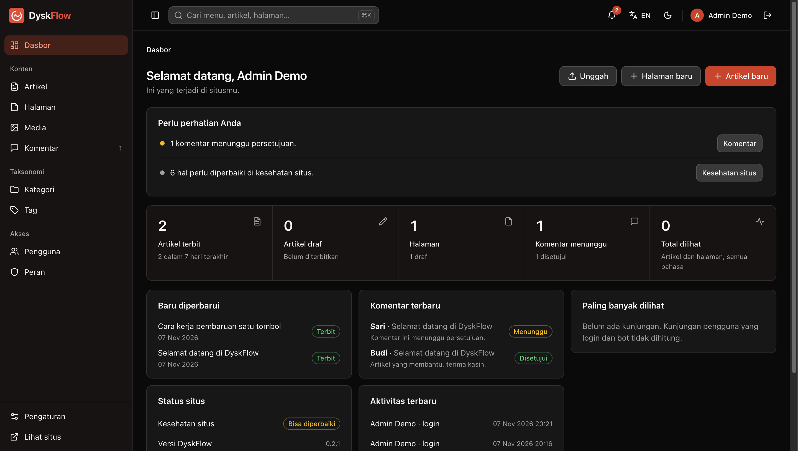
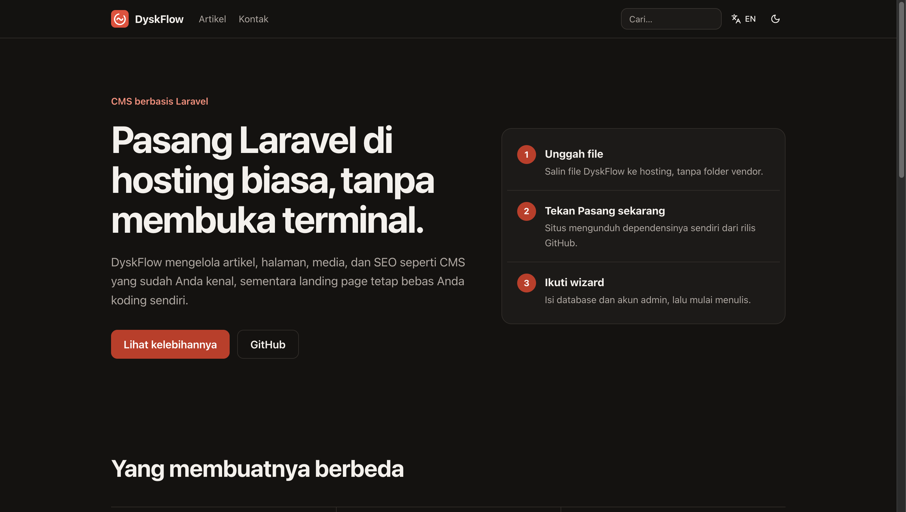
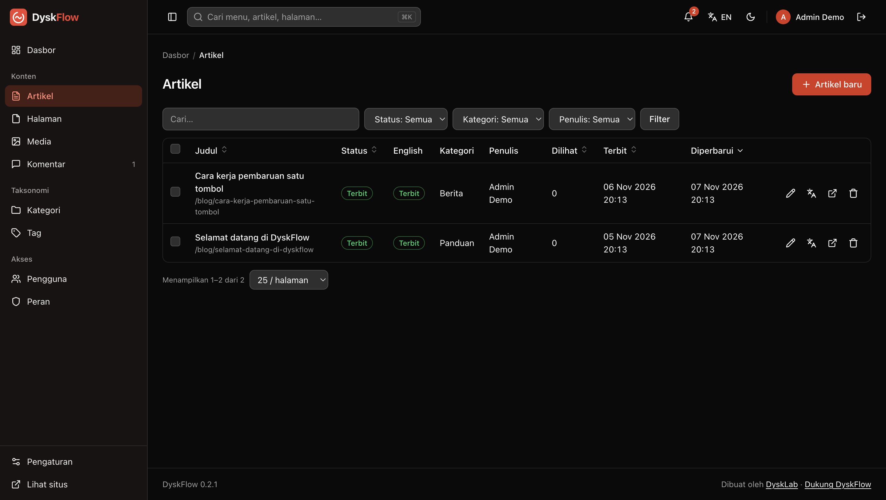
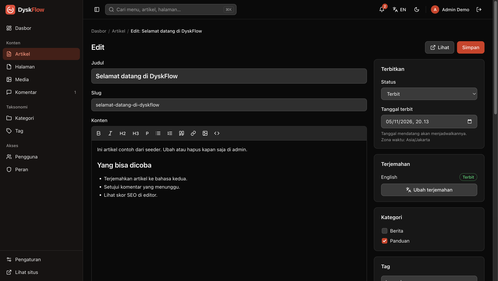
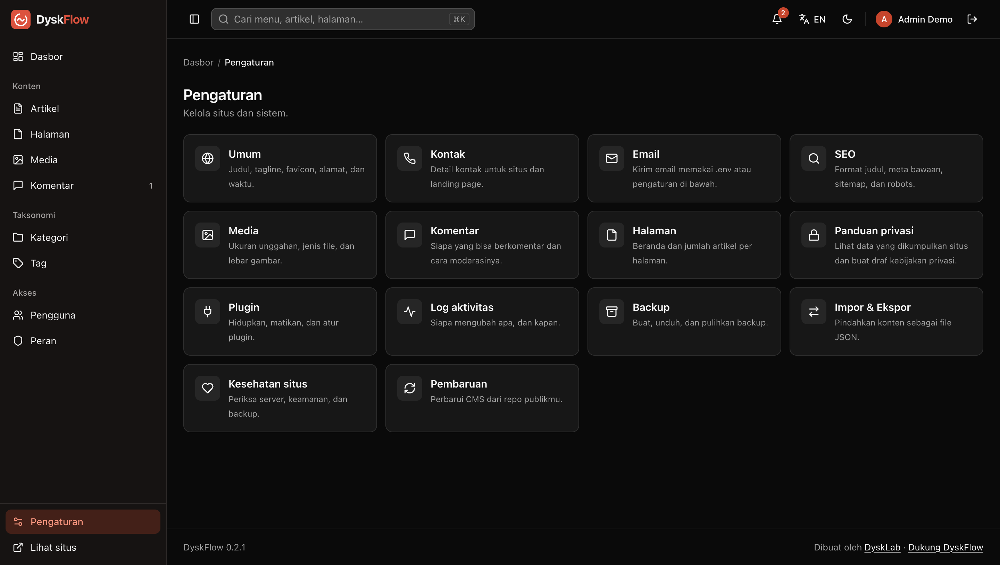

<p align="center">
  
</p>

<h1 align="center">DyskFlow</h1>

<p align="center">CMS Laravel yang dipasang tanpa terminal dan tanpa build step: unggah file, buka situsnya, ikuti wizard.</p>

<p align="center">
  <a href="https://github.com/DyskLab/dyskflow/releases/latest"></a>
  <a href="LICENSE"></a>
  <a href="https://www.fanny.dev/dysklab"></a>
  <a href="https://buymeacoffee.com/fannydevz"></a>
</p>



## Kenapa DyskFlow

- **Tanpa build:** tidak butuh Node atau Vite, dan hosting tidak perlu Composer. `vendor` dipasang dari halaman web.
- **Pembaruan satu tombol:** backup dibuat lebih dulu, lalu kode diambil dari rilis terbaru di GitHub.
- **Landing page bebas:** ditulis sebagai kode Blade terpisah, manual atau dengan AI.

## Pasang

**Butuh:** PHP 8.3+ dengan ekstensi `pdo_mysql` atau `pdo_sqlite`, `mbstring`, `openssl`, `fileinfo`, `dom`, dan `zip`. Opsional: `gd` dan `curl`.

1. [Unduh kode sumber](https://github.com/DyskLab/dyskflow/releases/latest), lalu unggah ke hosting tanpa folder `vendor`.
2. Buka situsnya dan tekan **Pasang sekarang**.
3. Ikuti wizard untuk mengisi database dan akun admin.

Langkah lengkap, termasuk cPanel dan komputer sendiri, ada di [SETUP.md](SETUP.md).

## Tampilan

| Landing page | Daftar artikel |
| --- | --- |
|  |  |
| **Editor artikel** | **Pengaturan** |
|  |  |

## Fitur

**Konten**
- Artikel dan halaman, kategori, tag, media, serta komentar dengan moderasi
- Sampah untuk artikel, halaman, dan komentar, sehingga yang terhapus masih bisa dipulihkan
- Jumlah views artikel dan halaman, tanpa cookie
- Dua bahasa (Indonesia dan Inggris) dengan URL per bahasa seperti `/en/blog/slug`. Halaman tanpa terjemahan tidak punya URL di bahasa itu

**SEO**
- Meta, canonical, Open Graph, JSON-LD, `hreflang`, pratinjau hasil pencarian, dan daftar periksa
- `sitemap.xml`, `robots.txt`, dan RSS per bahasa (`/feed`, `/en/feed`)

**Admin**
- Dasbor berisi hal yang perlu ditangani, ringkasan angka, komentar terbaru, jadwal terbit, dan status situs, sesuai izin tiap pengguna
- Pengguna dan peran, log aktivitas, backup, impor dan ekspor
- Pencarian global (`⌘K` atau `Ctrl+K`) dan notifikasi untuk komentar baru, versi baru, serta error
- Verifikasi dua langkah (TOTP) dengan kode pemulihan
- Panduan Privasi dan Kesehatan Situs
- Mode gelap, dengan antarmuka bahasa Indonesia dan Inggris

**Pengembangan**
- [Landing page](landing/README.md) sebagai kode Blade di folder `landing/`. Beranda dipilih di Pengaturan, dari landing page, daftar artikel, atau halaman biasa
- [Plugin](plugins/README.md) di folder `plugins/`, dengan hook dan halaman pengaturan otomatis

## Memperbarui situs

Buka **Pengaturan > Pembaruan > Periksa pembaruan > Perbarui sekarang**. Notifikasi muncul dalam 12 jam setelah admin membuka halaman admin.

- Backup database dibuat lebih dulu.
- Kode diambil dari rilis terbaru, dan `vendor` hanya diganti jika `composer.lock` berubah.
- Migrasi database dijalankan.
- `.env`, `storage`, `landing`, `plugins`, `public/uploads`, dan `cms.json` tidak pernah ditimpa.

## Data contoh

Setelah wizard selesai, perintah ini mengisi situs dengan kategori, tag, artikel, komentar, media contoh, dan draf Kebijakan Privasi. Perintah ini aman dijalankan ulang.

```bash
php artisan db:seed
```

## Terkunci dari TOTP

Pakai kode pemulihan saat login. Admin lain bisa memakai **Pengguna > Reset TOTP**. Jika tidak ada yang bisa login:

```bash
php artisan cms:totp-reset email@contoh.com
```

## Pengembangan

```bash
composer install
```

```bash
php artisan serve
```

```bash
php artisan test
```

### Merilis versi baru

1. Ubah isi `VERSION`, misalnya menjadi `0.3.0`, lalu commit.
2. Buat tag yang sama dan push:

```bash
git tag v0.3.0
```

```bash
git push origin main --tags
```

GitHub Actions membuat rilis berisi `vendor.zip` ([release.yml](.github/workflows/release.yml)). Fork perlu mengganti `"repo"` di `cms.json` dengan repo miliknya.

## Dukung proyek ini

DyskFlow gratis dan open source. Kalau bermanfaat, kamu bisa [mentraktir kopi di Buy Me a Coffee](https://buymeacoffee.com/fannydevz).

## Bagian dari DyskLab

DyskFlow adalah bagian dari [DyskLab](https://www.fanny.dev/dysklab), bersama [DyskFiles](https://github.com/DyskLab/dyskfiles), [DyskFocus](https://github.com/DyskLab/dyskfocus), dan DyskLink untuk [Mac](https://github.com/DyskLab/dysklink-mac) dan [Android](https://github.com/DyskLab/dysklink-android).

## Lisensi

[MIT](LICENSE)
